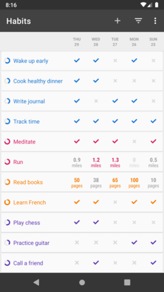

<h1 align="center">Salem - Focus & Habit Tracker</h1>

  
  
  

Salem is an app designed to help you focus on what truly matters to you and
break free from your dependence on the phone and social media. It helps you
build good habits, stay consistent and spend your time and attention on the
things that bring you closer to your long-term goals, with detailed graphs and
statistics that show how your habits improve over time. It is completely
ad-free and open source.

Salem is a fork of [Loop Habit Tracker][original] by Álinson Santos Xavier
(iSoron). It is being rebuilt with Jetpack Compose and Kotlin Multiplatform
(KMP), with the goal of bringing it to both Android and iOS (App Store).

> **Work in progress:** development is just getting started, so there are no
> Salem releases yet.

<!--
## Screenshots

TODO: add Salem screenshots here once they are available (see the screenshots/ folder).

-->

## Features

* **\*Beautiful, minimalistic and lightweight interface.** Loop has an elegant and minimalistic interface that is very easy to use, even for first-time users. Highly optimized for speed, the app works well even on older phones.

* **\*Habit score.** Loop has an advanced formula for calculating the strength of your habits. Every repetition makes your habit stronger and every missed day makes it weaker. A few missed days after a long streak, however, will not completely destroy your progress, unlike many other don't-break-the-chain apps.

* **\*Flexible schedules.** In addition to daily habits, Loop supports habits with more complex schedules, such as 3 times per week or every other day.

* **\*Reminders.** Schedule notifications to remind you of your habits. Each habit can have its own reminder, at a chosen time of the day. Easily check or dismiss your habit directly from the notification.

* **\*Widgets.** Be reminded of your habits whenever you unlock your phone. Colorful widgets allow you to track your habits directly from your home screen, without even opening the app.

* **\*Take control of your data.** If you want to further analyze your data, or move it to another service, Loop allows you to export it to spreadsheets (CSV) or to a database file (SQLite). For power users, checkmarks can be added through other apps, such as Tasker.

* **\*No limitations.** Track as many habits as you wish. Loop imposes no artificial limits on how many habits you can have. All features are available to all users. There are no in-app purchases.

* **\*Completely ad-free and open source.** There are no advertisements, annoying notifications or intrusive permissions in this app, and there will never be. The app is completely open-source (GPLv3).

* **\*Works offline and respects your privacy.** Loop doesn't require an Internet connection or online account registration. Your confidential data is never sent to anyone. Neither the developers nor any third-parties have access to it.

\* These features are part of the original Loop Habit Tracker app and, for the
most part, were not affected beyond visual changes.

## Original app

Salem has no installable release yet. If you want to try the app it is based on,
you can download the original Loop Habit Tracker or visit its repository:

* [Original repository (iSoron/uhabits)][original]
* [Loop Habit Tracker on Google Play][playstore]
* [Loop Habit Tracker on F-Droid][fdroid]

## Contributing

Salem is an open source project and contributions are welcome. There are many
ways to help, even if you are not a software developer.

* **Report bugs, suggest features.** To report a problem, please
  [create a new issue](https://github.com/crisacm/salem-focus-habits/issues/new).
  To share ideas or discuss new features, please visit our
  [GitHub Discussions page](https://github.com/crisacm/salem-focus-habits/discussions).

* **Spread the word.** If you like the project, share it with your family,
  friends and colleagues, and star the repository to help others find it.

* **Write some code.** Pull requests are welcome, whether you are an Android,
  iOS or Kotlin Multiplatform developer. Until Salem has its own contribution
  guidelines, the [original project's guidelines][guidelines] are a good
  reference.

## License

  Copyright (C) 2016-2025 Álinson Santos Xavier <isoron@gmail.com>

  Loop Habit Tracker is free software: you can redistribute it and/or modify
  it under the terms of the GNU General Public License as published by the
  Free Software Foundation, either version 3 of the License, or (at your
  option) any later version.

  Loop Habit Tracker is distributed in the hope that it will be useful, but
  WITHOUT ANY WARRANTY; without even the implied warranty of MERCHANTABILITY
  or FITNESS FOR A PARTICULAR PURPOSE. See the GNU General Public License for
  more details.

  You should have received a copy of the GNU General Public License along
  with this program. If not, see <https://www.gnu.org/licenses/>.

Salem is a derivative work of Loop Habit Tracker and is distributed under the
same license (GPLv3).

## Acknowledgements

Salem would not exist without [Loop Habit Tracker][original], created by
[Álinson Santos Xavier (iSoron)](https://github.com/iSoron) and developed over
the years by its many contributors and translators. All credit for the original
application, its design and its codebase goes to them. Thank you for building
and sharing such a great open source project.

[original]: https://github.com/iSoron/uhabits
[playstore]: https://play.google.com/store/apps/details?id=org.isoron.uhabits
[fdroid]: https://f-droid.org/app/org.isoron.uhabits
[guidelines]: https://github.com/iSoron/uhabits/blob/dev/docs/GUIDELINES.md
